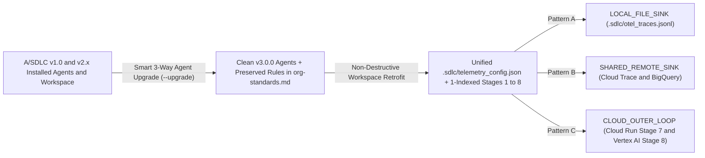

<!-- asdlc_version: "3.0.0" | distribution_tier: "customer-safe" -->
# 🚀 A/SDLC v3.0.0 Upgrade & Migration Guide (`v1.x` / `v2.x` to `v3.0.0`)

> **Current Release:** `v3.0.0` ([`VERSION`](./VERSION) • [`CHANGELOG.md`](./CHANGELOG.md))
> **Backward Compatibility:** **100% Backward-Compatible** with existing `v1.0.0` and `v2.x` project workspaces. Any workspace missing `.sdlc/telemetry_config.json` automatically defaults to **Pattern A (`LOCAL_FILE_SINK`)** with zero breaking changes.
> **Two Upgrade Modes Supported:**
> 1. **100% Pure Markdown Agent-Driven Smart 3-Way Upgrade (Recommended for Customer-Safe Repos & All Users):** Uses your AI agent to validate installed `v1.0` / `v2.x` agent definitions against canonical `v3.0.0` definitions, preserve custom prompt rules, upgrade installed skills and subagents, and non-destructively migrate `v1.0` project workspaces.
> 2. **CLI Script Shortcut (Optional for Workstream 1 R&D Checkouts):** Uses `bash scripts/install_asdlc.sh --target all` and `python3 scripts/sdlc_hud.py --outer-loop-init`.

---

## 1. What Changed in A/SDLC `v3.0.0` (At a Glance)

A/SDLC `v3.0.0` upgrades **Stage 7 (`@eval-telemetry-auditor`)** and **Stage 8 (`@kaizen-evolution-agent`)** from manual static checks into a telemetry-driven architecture powered by a **Unified 3-Pattern OpenTelemetry Sink Configuration (`.sdlc/telemetry_config.json`)**, **Dual-Mode Pure Markdown Agent Definitions (`asdlc_version: "3.0.0"`)**, and an **Always-On Cloud Outer-Loop (`deploy/cloud_outer_loop/`)**.



| Capability | A/SDLC `v1.0.0` | A/SDLC `v2.0` to `v2.2.1` | A/SDLC `v3.0.0` (Current) |
| :--- | :--- | :--- | :--- |
| **Lifecycle Stages** | 0-Indexed 7 Stages (`Stage 0` to `Stage 6`) | 1-Indexed 8 Stages (`Stage 1` to `Stage 8`) | 1-Indexed 8 Stages (`Stage 1` to `Stage 8`) with Split-Plane Inner/Outer Loop |
| **Agent & Skill Packaging** | Coupled to Python helper scripts | Hybrid Markdown + Python CLI | **100% Pure Markdown Customer-Safe Pack (`distribution_tier: "customer-safe"`)** with Dual-Mode native file handling |
| **Version & Drift Validation** | Manual file overwrite | `install_asdlc.sh` overwrite | **YAML Frontmatter `asdlc_version: "3.0.0"` + Smart 3-Way Agent Merge (`/agentic-sdlc --upgrade`)** |
| **OpenTelemetry Sink Discovery** | Hardcoded static string check in code | Static regex check on `EVAL_REPORT.md` | **Unified `.sdlc/telemetry_config.json`** (`LOCAL_FILE_SINK`, `SHARED_REMOTE_SINK`, `CLOUD_OUTER_LOOP`) |
| **Stage 7 Execution (`@eval-telemetry-auditor`)** | Manual chat invocation only | Manual chat or CLI invocation | **Manual Local OR Always-On Cloud Run + Cloud Build gVisor Sandbox (`--network=none`)** |
| **Stage 8 Execution (`@kaizen-evolution-agent`)** | Manual chat invocation only | Manual 4-Loop routing (`Loop 1..4`) | **Manual Local OR Event-Driven Vertex AI Agent Engine + `PENDING_KAIZEN_PR` Two-Phase Lock** |
| **PII & Credential Redaction** | Application-level only | Model Armor prompt screening | **Deterministic ADK 2.0 Scrubber (`redact_telemetry_payload`)** prior to any span or override persistence |

---

## 2. Part 1: Agent-Driven `v1.0` to `v3.0.0` Smart 3-Way Upgrade (Zero Scripts Required)

If you are upgrading from **A/SDLC `v1.0`** (or `v2.x`) using the **100% Pure Markdown Customer-Safe Repository**, your currently installed `~/.gemini/config/skills/agentic-sdlc/SKILL.md` is still on `v1.0` (which did not yet include the `--upgrade` command).

To solve this cleanly without running any bash or Python scripts, follow the **2-Step Bootstrap & Reload Flow** below:

### Step 1: Run the `v1.0` Bootstrap Upgrade Prompt
Clone or pull the `v3.0.0` repository (or unzip the Customer-Safe Markdown bundle) onto your workstation, open your AI IDE or CLI in that repository folder, and paste this single prompt:

```text
Read ./UPGRADE.md and ./skills/agentic-sdlc/SKILL.md in this v3.0.0 repository and execute the Smart 3-Way Agent & Workspace Upgrade against my installed ~/.gemini/config/ (or .agent/) definitions and my active A/SDLC project workspaces.
```

**What the Agent Does Automatically During Step 1:**
1. **Backs Up Installed `v1.0` Definitions:** Copies your existing `~/.gemini/config/agents/*.md` and `~/.gemini/config/skills/*/SKILL.md` (or `.agent/` equivalents) into `~/.gemini/config/.backups/asdlc-upgrade-<timestamp>/`.
2. **Validates Installed vs. Canonical `v3.0.0` Definitions (`asdlc_version: "3.0.0"`):** Compares every installed agent and skill against the canonical `v3.0.0` files in `./agents/` and `./skills/`.
3. **Smart 3-Way Merge (Preserves Your Custom Rules):** If you previously edited an installed `v1.0` agent (for example, adding company-specific security or coding rules inside `product-owner.md` or `security-governance-critic.md`), the agent extracts your custom rules and migrates them into your project's `org-standards.md` or `AGENTS.md` before installing the clean `v3.0.0` agent definition.
4. **Installs Clean `v3.0.0` Customer-Safe Agents & Skills:** Writes the 8 `v3.0.0` Customer-Safe agents (`project-conductor`, `product-owner`, `spec-architect`, `parallel-builder-orchestrator`, `security-governance-critic`, `eval-telemetry-auditor`, `kaizen-evolution-agent`, and `adversarial-doc-critic`), 4 core skills (`agentic-sdlc`, `asdlc-onboarding-coach`, `product-owner`, and `review-council`), and 6 stage templates into `~/.gemini/config/`.
5. **Non-Destructively Migrates Active `v1.0` Project Workspaces:**
   * Converts 0-indexed `v1.0` stages (`Stage 0` to `Stage 6`) into 1-indexed `v3.0.0` stages (`Stage 1` to `Stage 8`) inside `.sdlc/state.json`.
   * Scaffolds missing `v3.0.0` governance and telemetry files: `RACI.md`, `.sdlc/raci.json`, `.sdlc/git_config.json`, and `.sdlc/telemetry_config.json` (defaulting to `LOCAL_FILE_SINK` with `pii_redaction_enabled: true`).
   * Offers to append Section 7 (Day-2 Observability SLAs) to `PRD.md` and Section 5 (OpenTelemetry & Kaizen Override Contracts) to `SPEC.md`.

### Step 2: Reload the `agentic-sdlc` Skill (Start a Fresh Session)

> [!IMPORTANT]
> **Mandatory Reload After Upgrading from `v1.0`:** AI harnesses load skill and subagent system prompts into memory when a chat session starts. Immediately after Step 1 finishes updating `~/.gemini/config/skills/agentic-sdlc/SKILL.md` and `~/.gemini/config/agents/*.md`, **start a new chat session (or reload your IDE window)** so the newly installed `v3.0.0` `agentic-sdlc` skill and subagents are active in memory.
>
> **Future Upgrades (`v3.0.0` Onward):** Once `v3.0.0` is loaded in memory, `/agentic-sdlc --upgrade` is built directly into your installed skill (along with a silent startup version check), so future upgrades can be triggered anytime by typing `/agentic-sdlc --upgrade`.

---

## 3. Part 2: Configuring Your OpenTelemetry Sink Topology (`/agentic-sdlc --outer-loop-init`)

Once upgraded to `v3.0.0`, you can configure or switch your project's OpenTelemetry sink topology at any time by running `/agentic-sdlc --outer-loop-init` in chat (which updates `.sdlc/telemetry_config.json` and `.sdlc/cloud_outer_loop.json` directly using native file tools, or via `scripts/sdlc_hud.py --outer-loop-init` in full Workstream 1 R&D checkouts):

| Pattern | When to Use | What Gets Provisioned in `.sdlc/` |
| :--- | :--- | :--- |
| **Pattern A: `LOCAL_FILE_SINK` (Default)** | 100% local development, air-gapped environments, or initial pilot stages without cloud export. | `.sdlc/telemetry_config.json` (`sink_type: "LOCAL_FILE_SINK"`, `pii_redaction_enabled: true`), `.sdlc/otel_traces.jsonl`, and `.sdlc/kaizen_overrides.jsonl`. |
| **Pattern B: `SHARED_REMOTE_SINK`** | Application is deployed to a server or Cloud Run and exports spans to Cloud Trace / BigQuery, while Stage 7 & 8 agents run interactively on your workstation. | `.sdlc/telemetry_config.json` pointing to `cloud_trace_project` and `bigquery_dataset`, plus `.sdlc/cloud_outer_loop.json` (`enabled: false`). |
| **Pattern C: `CLOUD_OUTER_LOOP`** | Production cloud automation where Stage 7 runs on Cloud Run + Cloud Build gVisor sandbox (`--network=none`) and Stage 8 runs on Vertex AI Agent Engine + Pub/Sub. | `.sdlc/telemetry_config.json` (`sink_type: "CLOUD_OUTER_LOOP"`), `.sdlc/cloud_outer_loop.json` (`enabled: true`), and `deploy/cloud_outer_loop/` manifests. |

---

## 4. Part 3: CLI Shortcut for Workstream 1 R&D Maintainers (Optional)

If you are maintaining the full Workstream 1 Core Framework R&D repository (`<your-org>/asdlc-customer-kit`) with Python CLI tools installed locally:

```bash
# 1. Pull the latest v3.0.0 release on main
cd ~/Projects/asdlc-customer-kit
git checkout main
git pull origin main

# 2. Materialize all v3.0.0 skills, standalone scripts, and 9 specialist subagents
bash scripts/install_asdlc.sh --target all

# 3. Export and validate the sanitized 100% Pure Markdown Customer-Safe Repository bundle
python3 scripts/publish_customer_repo.py --target-dir ~/Projects/asdlc-customer-kit --verify
```
