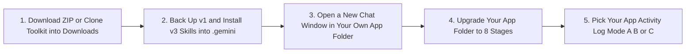

<!-- asdlc_version: "3.0.0" | distribution_tier: "customer-safe" -->
# Simple Upgrade Guide: Moving from A/SDLC v1 to v3

> [!CAUTION]
> **IMPORTANT LEGAL DISCLAIMER (`NO WARRANTY` • `NOT FOR PRODUCTION` • `EXAMPLE CODE ONLY` • `USE AT YOUR OWN RISK`):**
> * **Example Reference Code & Prompts Only (Not for Production or High-Risk OT Use):** All files, Markdown prompts, AI agent definitions (`agents/*.md`), skill definitions (`skills/*/SKILL.md`), and templates in this toolkit are **example reference materials** provided solely for educational and evaluation purposes. They are **NOT** intended, hardened, or certified for direct production use or for physical/industrial control systems (OT, SCADA, wellhead, pipeline, or grid control).
> * **Provided Strictly "AS IS" Without Warranty of Any Kind:** This repository and guide are provided **"AS IS"** without any express or implied warranty.
> * **Use 100% at Your Own Risk, Hold Harmless & Limitation of Liability:** Your use of these materials and any output generated by AI models is **100% at your own risk**. By using this toolkit, you agree to hold harmless and indemnify the author(s) and Google LLC from any claims, damages, data loss, repository changes, security incidents, or cloud/token billing charges.
> * **Unofficial Reference Material (Not an Official Google Product or Service):** This is an unofficial reference kit and is **not** an official Google LLC or Google Cloud product, service, or supported deliverable.
> * **Mandatory Human Review & Cloud Billing Responsibility:** Always have qualified human engineers review and test every AI-generated file or command before running or merging it, never enter sensitive PII or secrets into prompts, and manage your own cloud billing budgets and IAM controls. See **[`DISCLAIMER.md`](./DISCLAIMER.md)** for full legal terms.

> * **Current Version:** `v3.0.0` ([`VERSION`](./VERSION) • [`DISCLAIMER.md`](./DISCLAIMER.md))
> * **Customer-Safe Pure Markdown Toolkit (Recommended for All Users):** [https://github.com/cwserna/asdlc-customer-kit](https://github.com/cwserna/asdlc-customer-kit) • **[1-Click Download ZIP (No `git clone` Needed)](https://github.com/cwserna/asdlc-customer-kit/archive/refs/heads/main.zip)**
> * **Will This Break My Current Work?** **No.** Version 3 works smoothly with all your existing `v1` and `v2` project folders. None of your existing code, product plans (`PRD.md`), or technical blueprints (`SPEC.md`) will be deleted.
> * **How Long Does It Take?** **2 to 5 minutes** using simple copy-and-paste prompts in your AI chat window.

---

## Quick Jump Table of Contents

| Section | What You Will Find Here |
| :--- | :--- |
| **[Important First Rule: Two Separate Repos](#important-first-rule-do-not-confuse-the-toolkit-repo-with-your-own-app-repo)** | Why you must keep the downloaded **A/SDLC Toolkit folder** (`~/Downloads`) separate from **your own App Development Git repo**. |
| **[1. What Changed from v1 to v3](#1-what-changed-from-v1-to-v3-in-plain-english)** | Plain-English summary of the 8 steps (`Stages 1 to 8`), team roles (`RACI.md`), automatic GitHub saves, and app health logs. |
| **[2. Choose Your Upgrade Path](#2-choose-your-upgrade-path)** | Compare **Path A (Download ZIP or `git clone` + 2 Quick Prompts)** vs. **Path B (5 Copy-Paste Prompts Directly From This Guide)**. |
| **[3. Path A: Download the ZIP or `git clone` the v3 Toolkit](#3-path-a-download-the-zip-or-git-clone-the-v3-toolkit-and-run-the-upgrade)** | Fastest upgrade (~2 minutes) using the 1-Click ZIP download or `git clone`. |
| **[4. Path B: 5 Self-Contained Copy-Paste Prompts](#4-path-b-self-contained-5-prompt-upgrade-no-github-download-needed)** | Complete prompts (`Prompts 1 to 5`) to upgrade everything directly in chat without downloading any files. |
| **[5. Everyday v3 Chat Commands](#5-what-commands-can-you-use-after-upgrading-to-v3)** | Quick reference table of chat commands (`/agentic-sdlc --status`, `--resume`, `--new`, `--outer-loop-init`, `--upgrade`). |

---

## Important First Rule: Do Not Confuse the Toolkit Repo with Your Own App Repo

Before you download or clone anything, keep this one simple rule in mind. When you use A/SDLC, there are **two completely separate folders and Git repositories** that do two different jobs:

| Repository / Folder | What It Is | Where It Should Live on Your Computer | What You Do With It |
| :--- | :--- | :--- | :--- |
| **1. The A/SDLC v3 Toolkit Folder** (`asdlc-customer-kit`) | The **instruction manual and installer box** for your AI helpers. It holds the v3 agent `.md` files, skill `.md` files, and blank templates. | Put it in your **`Downloads`** folder, such as **`~/Downloads/asdlc-customer-kit`**. | You only download this ZIP (or `git clone` it) once so your AI can copy the v3 skills into `~/.gemini/config/`. **Never write your app code or run project stages inside this folder!** |
| **2. Your Own App Development Repo** (Your actual software project) | **Your team's own GitHub repository** where you build your real application, write code, and store your project's `PRD.md` and `SPEC.md`. | Lives in your own project workspace, such as **`~/projects/my-company-app`** (saved in `.sdlc/git_config.json`). | This is where you open your AI chat every day to run Stages 1 to 8, write your app code, and push your project commits to your own GitHub repo. |

> [!CAUTION]
> **Never unzip or `git clone` the A/SDLC Toolkit inside your own app's project folder, and never build your app inside `asdlc-customer-kit`.**
> Think of the A/SDLC Toolkit like an app installer you download into `~/Downloads`. Once your AI copies the v3 skills into `~/.gemini/config/`, close the `Downloads` folder and switch back to **your own app development folder** (`~/projects/<your-app>`) to upgrade and run your actual project.

---

## 1. What Changed from v1 to v3 in Plain English

Version 1 helped you plan and build software using 7 steps (numbered `Stage 0` to `Stage 6`). Version 3 makes the process easier to follow, safer for your company, and smarter after your app goes live:

1. **8 Clear Steps Instead of 7 (Numbered 1 to 8):**
   In v1, the first step was called `Stage 0`, which felt confusing. Version 3 numbers the 8 steps naturally from **`Stage 1` to `Stage 8`** and separates project setup (`Stage 1`) from product planning (`Stage 2`).
2. **100% Plain Text AI Helpers (No Hidden Code Required):**
   Every AI agent and skill is now a simple Markdown text file (`.md`) marked `asdlc_version: "3.0.0"`. Your security team can read and approve every file in minutes without worrying about hidden scripts.
3. **Keeps Your Custom Rules Safe When Upgrading:**
   If you added your own company rules inside any v1 AI agent file, the v3 upgrade saves a backup first, copies your custom rules into your project's **`org-standards.md`** file, and then installs the clean v3 agents.
4. **Clear Team Roles and Automatic GitHub Backups (`Stage 1`):**
   Every project now includes a simple **Team Roles Sheet (`RACI.md`)** so everyone knows which person approves each step. It also connects to **your own app's GitHub repository (`.sdlc/git_config.json`)** so every approved step is saved automatically.
5. **Gentler AI Interviews (2 to 3 Questions at a Time):**
   Instead of overwhelming you with a giant wall of questions, your AI helpers ask **2 to 3 simple questions per turn** and keep going until everything is clear.
6. **Built-In App Health Logs and Privacy Protection (`Stages 7 and 8`):**
   Your app now writes **App Activity Logs** and saves **User Feedback Clicks** so the Testing Agent (`Stage 7`) and Improvement Agent (`Stage 8`) can spot real problems. An **Automatic Privacy Filter** scrubs passwords, secret keys, emails, and phone numbers before any log is saved.



### Quick Comparison: v1 vs. v3

| Feature | How It Worked in v1 | How It Works in v3 |
| :--- | :--- | :--- |
| **Project Steps** | 7 steps numbered `Stage 0` to `Stage 6` | **8 clear steps numbered `Stage 1` to `Stage 8`** |
| **AI Files** | Relied on Python helper scripts | **100% plain text Markdown files (`.md`)** that work directly in chat |
| **Upgrading Agents** | Overwrote files and could erase custom edits | **Backs up v1 first and moves your custom rules into `org-standards.md`** |
| **Team Approvals** | Single owner in state file | **6-Role Team Responsibility Sheet (`RACI.md`)** |
| **GitHub Saving** | Manual `git` commands | **Checked in Stage 1 (`.sdlc/git_config.json`) and saved to your own app repo at every gate** |
| **AI Questions** | Fixed number of questions | **2 to 3 questions at a time** until your plan is 100% complete |
| **App Activity Logs** | Basic text check | **3 simple log modes (`.sdlc/telemetry_config.json`)** with automatic privacy scrubbing |

### How Your Old v1 Stage Numbers Map to v3

When you upgrade an existing v1 project folder, your completed steps map to the new 8-stage numbering automatically:

| Old v1 Stage | New v3 Stage | What Happens in This Step |
| :--- | :--- | :--- |
| `Stage 0` (Setup & Product Plan) | **`Stage 1` & `Stage 2`** | **Stage 1** handles Project Setup, Team Roles (`RACI.md`), Your App's GitHub Repo, App Log Mode, and Reference Files (`.okf/intake/`). **Stage 2** creates your Product Plan (`PRD.md`). |
| `Stage 1` (Technical Design) | **`Stage 3`** | Creates your Technical Blueprint (`SPEC.md`). |
| `Stage 2` (Workspace Setup) | **`Stage 4`** | Sets up your Workspace Rules (`AGENTS.md`) and custom Coding Builders (`.sdlc/agents/builders/`). |
| `Stage 3` (Coding) | **`Stage 5`** | Runs your Coding Builders in parallel waves to write the app. |
| `Stage 4` (Security Check) | **`Stage 6`** | Reviews your code for security problems (`SECURITY_AUDIT.md`). |
| `Stage 5` (Testing & Cost Check) | **`Stage 7`** | Runs automated tests, checks App Activity Logs, and reviews AI cost (`EVAL_REPORT.md`). |
| `Stage 6` (Improvements) | **`Stage 8`** | Reads live logs and user feedback to plan the next improvement (`KAIZEN_REPORT.md`). |

---

## 2. Choose Your Upgrade Path

Pick whichever upgrade path is easiest for you:

| Upgrade Path | Best For... | Time Needed | Where to Go |
| :--- | :--- | :---: | :--- |
| **Path A: Download ZIP (or `git clone`) + 2 Quick Prompts** *(Recommended)* | Anyone who can download the ZIP file ([main.zip](https://github.com/cwserna/asdlc-customer-kit/archive/refs/heads/main.zip)) or run `git clone` into `~/Downloads`. | **~2 minutes** | Jump to **[Section 3 (Path A)](#3-path-a-download-the-zip-or-git-clone-the-v3-toolkit-and-run-the-upgrade)** |
| **Path B: 5 Copy-Paste Prompts From This Document** | Anyone working in an environment without GitHub download access who wants to copy and paste prompts directly from this guide. | **~5 minutes** | Jump to **[Section 4 (Path B)](#4-path-b-self-contained-5-prompt-upgrade-no-github-download-needed)** |

---

## 3. Path A: Download the ZIP or `git clone` the v3 Toolkit and Run the Upgrade

### Step 1: Download the ZIP (Recommended if You Prefer Not to Use `git clone`) or `git clone` into `~/Downloads`

Remember: put this toolkit inside a separate folder like `~/Downloads` so you **never** confuse the A/SDLC Toolkit folder with your own app's development repository. Pick **Option 1** or **Option 2**:

#### Option 1 (Recommended if You Prefer Not to Use `git clone`): Direct 1-Click ZIP Download
If you prefer not to run `git clone` in the terminal, download the ZIP file directly in your web browser:
1. Click this direct link to download the v3 Customer-Safe Toolkit ZIP:
   **[https://github.com/cwserna/asdlc-customer-kit/archive/refs/heads/main.zip](https://github.com/cwserna/asdlc-customer-kit/archive/refs/heads/main.zip)**
   *(Or open **[https://github.com/cwserna/asdlc-customer-kit](https://github.com/cwserna/asdlc-customer-kit)** in your browser, click the green **`<> Code`** button near the top right, and click **`Download ZIP`**.)*
2. Open your computer's **`Downloads`** folder and double-click `asdlc-customer-kit-main.zip` to unzip it (`~/Downloads/asdlc-customer-kit-main`).
3. Leave this unzipped toolkit folder inside `Downloads` so it stays completely separate from the Git repository you use for your actual app development.

#### Option 2 (If You Prefer Using the Terminal): `git clone` From GitHub
Open your terminal and run these commands to clone the **Customer-Safe Pure Markdown Toolkit** ([https://github.com/cwserna/asdlc-customer-kit](https://github.com/cwserna/asdlc-customer-kit)) into `~/Downloads/asdlc-customer-kit`:

```bash
# 1. Go to your Downloads folder (OUTSIDE your own app development repo!)
cd ~/Downloads

# 2. Clone the Customer-Safe v3 Toolkit repository from GitHub:
git clone https://github.com/cwserna/asdlc-customer-kit.git

# 3. Move into the downloaded toolkit folder:
cd ~/Downloads/asdlc-customer-kit
```

---

### Step 2: Install the v3 Skills & Agents into `~/.gemini/config/` (Paste Inside the Downloaded Toolkit Folder)

Open your AI chat window inside that downloaded `~/Downloads/asdlc-customer-kit` (or `~/Downloads/asdlc-customer-kit-main`) folder and paste this prompt:

```text
Read ./UPGRADE.md and ./skills/agentic-sdlc/SKILL.md in this downloaded v3.0.0 toolkit folder and upgrade my installed ~/.gemini/config/ skills and agents from v1 to v3.0.0:
1. Back up all my current v1 agents and skills into ~/.gemini/config/.backups/asdlc-v1-backup-<timestamp>/ first.
2. Check if I added any custom company rules inside my v1 agent files in ~/.gemini/config/agents/, and save those custom rules into ~/.gemini/config/.backups/migrated-custom-rules.md so nothing is lost.
3. Copy and install all 8 customer-safe agents (./agents/*.md), all 4 skills (./skills/*/SKILL.md), and all 6 templates (./skills/agentic-sdlc/resources/*.md) from this toolkit folder into ~/.gemini/config/ so they are installed globally for all my projects.
4. IMPORTANT: Do NOT create .sdlc/, RACI.md, or any project files inside this ~/Downloads/asdlc-customer-kit toolkit folder.
5. Show me a summary of the files backed up and installed, and remind me to close this Downloads folder and open a new chat window inside my own app development folder for Step 3.
```

---

### Step 3: Switch to Your Own App Folder in a New Chat Window and Upgrade Your Project

> [!IMPORTANT]
> **Close `~/Downloads/asdlc-customer-kit` and Open a Brand-New Chat Window Inside Your Own App Folder!**
> You are finished with the `Downloads` toolkit folder. Open a **brand-new chat window** inside **your own software project folder** (for example, `~/projects/my-company-app`) so your AI loads the new v3 skills, then paste this prompt:

```text
Please upgrade my current app development project folder from A/SDLC v1 to v3.0.0:
1. Verify first that this folder is my own application project and NOT the asdlc-customer-kit or agentic-sdlc-harness toolkit folder. If ~/.gemini/config/.backups/migrated-custom-rules.md exists, append those custom rules into my project's org-standards.md.
2. Back up .sdlc/state.json to .sdlc/state.v1.backup.json, then convert my v1 stages (Stage 0 through Stage 6) into the v3 stages (Stage 1 through Stage 8) with schema_version: "3.0.0" while keeping all existing approval timestamps and notes.
3. Create any missing v3 project files without overwriting my existing PRD.md, SPEC.md, org-standards.md, or AGENTS.md:
   * RACI.md and .sdlc/raci.json (6 team roles across Stages 1 to 8)
   * .sdlc/git_config.json: check git remote get-url origin in this folder (or ask me via ask_question for my app's GitHub URL). Never save asdlc-customer-kit or agentic-sdlc-harness as my app's Git remote!
   * .sdlc/telemetry_config.json (defaulting to LOCAL_FILE_SINK with pii_redaction_enabled: true), .sdlc/otel_traces.jsonl, and .sdlc/kaizen_overrides.jsonl.
4. Show me my updated 8-Stage Project Status Board (Stages 1 to 8).
```

---

## 4. Path B: Self-Contained 5-Prompt Upgrade (No GitHub Download Needed)

If you only have this guide and cannot download the ZIP or `git clone` from GitHub, open your AI chat window inside **your own app development folder** and copy and paste **Prompts 1 through 5** below one at a time.

---

### Prompt 1 of 5: Check Your Current v1 Setup and Create a Safe Backup

| Where to Paste It | Time | What This Prompt Does |
| :--- | :---: | :--- |
| Inside your existing chat window (in your app folder) | ~30 sec | Finds your v1 files, saves a full backup copy in `~/.gemini/config/.backups/`, and lists any custom rules you added. |

```text
I am upgrading my A/SDLC setup from v1 to v3.0.0. Please perform Step 1 (Pre-Check and Safe Backup) using your file tools:

1. Locate my installed A/SDLC files in ~/.gemini/config/ (checking ~/.gemini/config/agents/, ~/.gemini/config/skills/, and ~/.gemini/asdlc/projects_registry.json) as well as any local .agent/ or .sdlc/ folder in my current workspace.
2. Create a timestamped backup folder at ~/.gemini/config/.backups/asdlc-v1-backup-<YYYYMMDD-HHMMSS>/ and copy every existing agent (.md), skill (SKILL.md), projects_registry.json, and active project .sdlc/state.json file into that backup folder.
3. Inspect my existing v1 agent files and skill files to see if I added any custom company rules, security policies, coding conventions, or special instructions.
4. Do not overwrite my installed files yet. Show me a simple checklist in plain English listing:
   * Where my v1 backup was saved
   * Which v1 skills and agents were found
   * Which existing A/SDLC project folders were found (and what v1 stage they are on)
   * Any custom rules found inside my v1 agents that should be saved into org-standards.md or AGENTS.md during Prompt 2.
```

---

### Prompt 2 of 5: Upgrade All AI Skills and Agents to v3 (While Keeping Your Custom Rules and Full Agent Details)

| Where to Paste It | Time | What This Prompt Does |
| :--- | :---: | :--- |
| Same chat window (right after Prompt 1) | ~1 min | Moves your custom rules into `org-standards.md`, preserves your detailed v1 agent rubrics, and upgrades all 4 skills, 6 stage templates, and 8 customer-safe agents to v3.0.0. |

```text
Now execute Step 2 of my v1 to v3.0.0 upgrade (Preserve Custom Rules and Upgrade Skills, Templates, and Agents to v3.0.0):

1. Preserve My Custom Rules First:
   If Step 1 found any custom company rules or instructions inside my old v1 agent or skill files, append them cleanly under a "## Migrated Custom Rules from v1" section inside my project's org-standards.md (and AGENTS.md if they are coding guardrails) so zero custom rules are lost.

2. IMPORTANT Rule to Prevent Shortened or Incomplete Files:
   Never replace an existing detailed agent or skill file with a short stub! When updating ~/.gemini/config/agents/*.md and ~/.gemini/config/skills/*/SKILL.md, keep all existing detailed security checklists, testing dimensions, and review rules from my backed-up v1 files and merge the v3.0.0 additions below into them.

3. Write or Update the 4 Core v3.0.0 Skills in ~/.gemini/config/skills/ (and .agent/skills/ if my workspace uses .agent/):
   Every SKILL.md file MUST start with YAML frontmatter containing:
   name: <skill-name>
   asdlc_version: "3.0.0"
   distribution_tier: "customer-safe"

   Ensure these 4 skills include full v3.0.0 instructions:
   * skills/agentic-sdlc/SKILL.md:
     Orchestrates the 8-Stage A/SDLC v3.0 workflow (numbered Stages 1 to 8) using native file tools (read_file, write_file, edit_file, ask_question, run_command) with zero required Python scripts:
     - Stage 1 (@project-conductor, Accountable: executive_sponsor): Project Onboarding, 6-Role RACI (RACI.md and .sdlc/raci.json), Mandatory GitHub/Git Repository Setup and Read/Write Validation for the user's own app development repository (.sdlc/git_config.json with access_verified: true, never confused with the A/SDLC toolkit repo), 3-Mode App Activity Log Setup (.sdlc/telemetry_config.json and .sdlc/cloud_outer_loop.json), 6-Part Background Asset & Data Source Intake (.okf/intake/designs/, .okf/intake/styles/, .okf/intake/docs/, .okf/intake/schemas/, and .okf/intake/ASSET_MANIFEST.md), and Tech Stack Profile (.sdlc/tech_stack.json).
     - Stage 2 (@product-owner, Accountable: product_owner): 4-Phase Product Discovery Interview grounded in Stage 1 assets to produce PRD.md (including Section 7: Day-2 App Health Logs & Feedback Goals).
     - Stage 3 (@spec-architect, Accountable: lead_architect): Technical Blueprint interview producing stack-adaptive SPEC.md (including Section 5: App Activity Log Exporter, Privacy Filter, and POST /api/v1/kaizen/override Contract, plus Section 6: Proposed Parallel Builder Decomposition Plan).
     - Stage 4 (@parallel-builder-orchestrator + @spec-architect, Accountable: lead_architect): Creates 1..N project-specific builders in .sdlc/agents/builders/<builder-id>.md and .sdlc/builder_manifest.json with non-overlapping folder ownership, writes AGENTS.md (<= 150 lines) and .okf/manifest.yaml, and creates deploy/cloud_outer_loop/ when Mode C (CLOUD_OUTER_LOOP) is active.
     - Stage 5 (@parallel-builder-orchestrator, Accountable: tech_lead): Runs parallel coding builders in waves, wiring live App Activity Log output (.sdlc/otel_traces.jsonl locally and Cloud Trace/BigQuery in cloud mode), automatic privacy redaction callbacks (scrubbing emails, phone numbers, SSNs, API keys, and tokens), and POST /api/v1/kaizen/override.
     - Stage 6 (@security-governance-critic, Accountable: security_lead): Red-team security and governance review auditing prompt injection, tool poisoning, least-privilege IAM, SQL/command injection, privacy redaction, and SPEC.md compliance, producing SECURITY_AUDIT.md.
     - Stage 7 (@eval-telemetry-auditor, Accountable: sre_finops_lead): Runs automated tests, scores outputs across the 7 Quality Dimensions (Correctness, Groundedness, Safety, Tool Trajectory, Latency, Token Cost, and Log Completeness), checks live logs from .sdlc/telemetry_config.json, and writes EVAL_REPORT.md.
     - Stage 8 (@kaizen-evolution-agent + @project-conductor, Accountable: product_owner): Reads live logs and user feedback from .sdlc/telemetry_config.json, promotes edge cases into .sdlc/golden_eval_set.json, appends learned guardrails to AGENTS.md (<= 150 lines), writes KAIZEN_REPORT.md, and routes improvements via Loop 1 (Stage 4/5 Bug or Rule), Loop 2 (Stage 3 Delta Feature in SPEC.md), Loop 3 (Stage 2 New Epic in PRD.md), or Loop 4 (Stage 1 Charter/RACI/Assets).
     - Interview Pacing Rule: Across Stages 1 to 4, ask only 2 to 3 focused questions per turn via ask_question and continue across as many turns as needed until 100% of the stage checklist is answered.
     - Supported Commands: --new, --resume [id|path], --status [id], --list, --park [id], --delete [id], --upgrade, --git-setup <url>, --git-status, --git-sync [stage], --outer-loop-init, --outer-loop-status, --remote-set <url>, --remote-status, --remote-sync, --remote-remove, --clone <id> --url <url>.

   * skills/asdlc-onboarding-coach/SKILL.md:
     Pre-Flight Environment, Google Cloud, App Activity Log APIs, Git/GitHub, and Toolkit Setup Coach (/asdlc-onboarding-coach). Verifies Gates G01 to G12 (GCP project, billing cap, Gemini Enterprise seat, security settings, developer IAM roles, the 8 core Inner-Loop APIs plus 10 Cloud Log/Outer-Loop APIs when using Modes B or C, Python 3.12+, git config and gh auth status, gcloud login, Antigravity business account login, and toolkit health check) and stops cleanly before Stage 1 (/agentic-sdlc --new).

   * skills/product-owner/SKILL.md:
     Runs the Stage 2 4-Phase Product Owner interview (Phase 1 Vision & Value, Phase 2 Scope, Epics & Data Source Access Rules, Phase 3 MoSCoW User Stories & Acceptance Criteria, Phase 4 PRD.md Handoff) grounded in org-standards.md and .okf/intake/ assets, asking 2 to 3 questions per turn until 100% complete.

   * skills/review-council/SKILL.md:
     Runs a 4-Seat Blind Adversarial Review Council (Industry/Regulatory Expert, IT Security Expert, Executive Narrative & Formatting Critic, and Specialized Technical Expert) plus Action Plan synthesis to stress-test code or documents.

4. Write the 6 Stage Templates into ~/.gemini/config/skills/agentic-sdlc/resources/:
   * RACI_TEMPLATE.md: Markdown table and role definitions assigning Responsible (R), Accountable (A), Consulted (C), and Informed (I) across Stages 1 to 8 for the 6 enterprise roles (executive_sponsor, product_owner, lead_architect, tech_lead, security_lead, sre_finops_lead).
   * ASSET_MANIFEST_TEMPLATE.md: 6-Part Stage 1 Intake checklist recording file paths, owners, and status for (1) org-standards.md, (2) UI/UX designs, (3) brand/style guides, (4) domain docs, (5) API/database schemas, and (6) external/internal data source inventory.
   * ORG_STANDARDS_TEMPLATE.md: Complete organizational engineering template covering Approved Tech Stack, Least-Privilege IAM, Testing Floor (>= 35% coverage), Mandatory Privacy Redaction in Logs, and AI Cost/Model Routing standards.
   * PRD_TEMPLATE.md: Complete 7-section Product Requirements template: (1) Executive Vision & KPIs, (2) Target Personas, (3) Scope & Epics, (4) MoSCoW User Stories & Given/When/Then Acceptance Criteria, (5) Data Source Access & Privacy Rules, (6) Risks & Dependencies, and (7) Day-2 App Health Logs & Feedback Goals.
   * SPEC_TEMPLATE.md: Complete 7-section Technical Specification template: (1) System Architecture & Stack Profile, (2) Data Models & Schemas, (3) API Endpoints & Error Contracts, (4) UI Component Hierarchy & State, (5) App Activity Log Exporter, Privacy Filter & POST /api/v1/kaizen/override Contract, (6) Proposed Parallel Builder Decomposition Plan (non-overlapping folder ownership), and (7) Security & IAM Boundaries.
   * AGENTS_TEMPLATE.md: Concise <= 150-line workspace guardrail template containing Tech Stack summary, Folder Ownership rules, Coding/Testing rules, Security boundaries, and Learned Kaizen Rules.

5. Upgrade or Write All 8 Customer-Safe v3.0.0 Specialist Agents in ~/.gemini/config/agents/ (keeping all detailed v1 instructions and adding YAML frontmatter with name, description, asdlc_version: "3.0.0", and distribution_tier: "customer-safe"):
   * agents/project-conductor.md (@project-conductor): Owns Stage 1 onboarding (6-Role RACI, app GitHub repo validation in .sdlc/git_config.json, 3-Mode App Activity Log setup in .sdlc/telemetry_config.json, 6-Part asset intake in .okf/intake/), v1-to-v3 Smart 3-Way Upgrade (--upgrade), and Stage-Gate Git sync across Stages 1 to 8.
   * agents/product-owner.md (@product-owner): Owns Stage 2 discovery across 4 phases (2 to 3 questions per turn until 100% complete) grounded in Stage 1 assets to produce PRD.md.
   * agents/spec-architect.md (@spec-architect): Owns Stage 3 & 4 technical scoping (2 to 3 questions per turn until 100% complete), authoring SPEC.md (including Section 5 App Activity Log & Feedback contracts and Section 6 Parallel Builder Decomposition Plan) and Stage 4 AGENTS.md.
   * agents/parallel-builder-orchestrator.md (@parallel-builder-orchestrator): Owns Stage 4 & 5 builder synthesis (.sdlc/agents/builders/<id>.md and .sdlc/builder_manifest.json), Gate 4 roster approval, and Stage 5 parallel coding waves with live log export and privacy redaction.
   * agents/security-governance-critic.md (@security-governance-critic): Owns Stage 6 adversarial code & config audit (prompt injection, tool poisoning, IAM boundaries, SQL/command injection, privacy redaction, and SPEC.md drift) producing SECURITY_AUDIT.md.
   * agents/eval-telemetry-auditor.md (@eval-telemetry-auditor): Owns Stage 7 automated test execution, 7-Dimension quality scoring, live log verification via .sdlc/telemetry_config.json, and AI cost audit producing EVAL_REPORT.md.
   * agents/kaizen-evolution-agent.md (@kaizen-evolution-agent): Owns Stage 8 continuous improvement, reading .sdlc/telemetry_config.json logs and .sdlc/kaizen_overrides.jsonl feedback, updating .sdlc/golden_eval_set.json and AGENTS.md, writing KAIZEN_REPORT.md, and routing via Loops 1 to 4.
   * agents/adversarial-doc-critic.md (@adversarial-doc-critic): Cross-stage 4-Lens Document & Architecture Critic (Principal Architect, Skeptical Customer CTO, Fact-Checker, and Readability Critic).

6. When finished, confirm every file updated and remind me to open a brand-new chat window before running Prompt 3 so the new v3.0.0 skills and agents load into memory.
```

> [!IMPORTANT]
> **Stop and Open a New Chat Window Now!**
> As soon as Prompt 2 finishes, **start a new chat window** (or reload your AI editor) inside **your own app development folder** before pasting Prompt 3. This loads your newly upgraded v3.0.0 skills and agents into active memory.

---

### Prompt 3 of 5: Upgrade Your Existing v1 Project Folder to v3 (Run in Your New Chat Window)

| Where to Paste It | Time | What This Prompt Does |
| :--- | :---: | :--- |
| **In a brand-new chat window** inside your own app folder | ~1 min | Converts `Stage 0..6` to `Stage 1..8` in `.sdlc/state.json`, creates `RACI.md`, links your app's GitHub repo in `.sdlc/git_config.json`, and keeps all your code and docs safe. |

```text
Please upgrade my existing v1 A/SDLC project workspace to v3.0.0 (Non-Destructive Workspace Migration):

1. Verify first that this current working directory is my own application project folder and NOT the downloaded asdlc-customer-kit or agentic-sdlc-harness toolkit folder.
2. Read my existing .sdlc/state.json (and ~/.gemini/asdlc/projects_registry.json if present). Save a backup copy of .sdlc/state.json to .sdlc/state.v1.backup.json.
3. Convert the old v1 stage numbers (Stage 0 through Stage 6) into the new v3.0.0 stage numbers (Stage 1 through Stage 8) inside .sdlc/state.json:
   * If v1 Stage 0 was approved, mark both Stage 1 (Project Onboarding, RACI, GitHub & Asset Intake) and Stage 2 (Product Discovery & PRD.md) as APPROVED in .sdlc/state.json. If v1 Stage 0 was in progress and PRD.md already exists, mark Stage 1 APPROVED and Stage 2 IN_PROGRESS.
   * Map v1 Stage 1 -> v3 Stage 3 (Technical Blueprint SPEC.md)
   * Map v1 Stage 2 -> v3 Stage 4 (Workspace & Builder Synthesis AGENTS.md)
   * Map v1 Stage 3 -> v3 Stage 5 (Parallel Builder Execution)
   * Map v1 Stage 4 -> v3 Stage 6 (Security & Governance Review)
   * Map v1 Stage 5 -> v3 Stage 7 (Testing, Quality & Cost Check)
   * Map v1 Stage 6 -> v3 Stage 8 (Continuous Improvement & Next Iteration)
   * Set schema_version to "3.0.0" and preserve all existing gate approval timestamps, notes, and history.
4. Create any missing v3.0.0 project governance files without overwriting my existing PRD.md, SPEC.md, org-standards.md, or AGENTS.md:
   * RACI.md and .sdlc/raci.json (mapping the 6 team roles across Stages 1 to 8)
   * .sdlc/git_config.json: check git remote get-url origin in this folder (or ask me via ask_question for my app's GitHub repository URL). Hard Guardrail: NEVER save asdlc-customer-kit or agentic-sdlc-harness into .sdlc/git_config.json!
   * .okf/intake/designs/, .okf/intake/styles/, .okf/intake/docs/, .okf/intake/schemas/ directories and .okf/intake/ASSET_MANIFEST.md
   * .sdlc/golden_eval_set.json (seeded with an initial test case list if not present)
5. Non-destructively append the v3.0.0 Day-2 App Activity Log & Feedback sections to my existing documents if they are not already present:
   * Append "Section 7: Day-2 App Health Logs & Continuous Improvement Goals" to PRD.md
   * Append "Section 5: App Activity Log Exporter, Privacy Filter & User Feedback Endpoint (POST /api/v1/kaizen/override)" to SPEC.md
6. Show me my updated 8-Stage Project Status Board (Stages 1 to 8).
```

---

### Prompt 4 of 5: Set Up App Activity Logs and Automatic Feedback (Pick Mode A, B, or C)

In Version 3, your app records **App Activity Logs** and **User Feedback Clicks** so the Testing Agent (`Stage 7`) and Improvement Agent (`Stage 8`) can inspect how your app performs in real life.

First, pick which of the **3 simple log modes** fits your project:

| Log Mode | Plain-English Meaning | Best When... | What Gets Created |
| :--- | :--- | :--- | :--- |
| **Mode A: Local File Mode (`LOCAL_FILE_SINK`)** *(Recommended Default)* | Saves app activity logs and user feedback clicks into two simple files right inside your project folder on your computer. | You are building or testing on your laptop, or want the simplest setup with zero extra cloud services. | `.sdlc/telemetry_config.json`, `.sdlc/otel_traces.jsonl`, and `.sdlc/kaizen_overrides.jsonl` |
| **Mode B: Shared Cloud Log Mode (`SHARED_REMOTE_SINK`)** | Your deployed app sends logs to Google Cloud (`Cloud Trace` and `BigQuery`). When you run Stage 7 or Stage 8 on your laptop, your AI helpers read those cloud logs. | Your app runs on a shared server or Cloud Run, and you run your AI helpers from your computer when needed. | `.sdlc/telemetry_config.json` linked to your Google Cloud project |
| **Mode C: Automatic Cloud Helper Mode (`CLOUD_OUTER_LOOP`)** | Both your app and your Stage 7 and Stage 8 AI helpers run automatically in Google Cloud. Untrusted tests run inside a safe isolated cloud sandbox with internet access turned off, and Stage 8 can open up to 5 GitHub pull requests per day on your app's GitHub repo for your team to review. | Your app is in production and you want automatic cloud testing and improvement pull requests. | `.sdlc/telemetry_config.json`, `.sdlc/cloud_outer_loop.json`, and `deploy/cloud_outer_loop/` cloud setup files |

| Where to Paste It | Time | What This Prompt Does |
| :--- | :---: | :--- |
| In your active project chat window | ~1 min | Lets you choose Mode A, B, or C and creates `.sdlc/telemetry_config.json` with automatic privacy scrubbing enabled. |

```text
Please configure my A/SDLC v3.0.0 App Activity Logs and Feedback setup (/agentic-sdlc --outer-loop-init):

1. Ask me (via ask_question) which of the 3 App Activity Log modes I want for this project:
   * (Recommended) Mode A: LOCAL_FILE_SINK (saves logs locally in .sdlc/otel_traces.jsonl and .sdlc/kaizen_overrides.jsonl with zero cloud setup)
   * Mode B: SHARED_REMOTE_SINK (app sends logs to Google Cloud Trace and BigQuery; I run Stage 7 and Stage 8 from my workstation)
   * Mode C: CLOUD_OUTER_LOOP (always-on Google Cloud Run Stage 7 safe test sandbox + Vertex AI Stage 8 automatic GitHub pull requests)
2. Write .sdlc/telemetry_config.json with:
   * schema_version: "3.0.0"
   * sink_type: my chosen mode ("LOCAL_FILE_SINK", "SHARED_REMOTE_SINK", or "CLOUD_OUTER_LOOP")
   * local_traces_path: ".sdlc/otel_traces.jsonl"
   * local_overrides_path: ".sdlc/kaizen_overrides.jsonl"
   * pii_redaction_enabled: true (scrubbing emails, phone numbers, SSNs, API keys, and bearer tokens before any log is saved)
   * edge_sqlite_buffer_path: ".sdlc/edge_telemetry_buffer.db"
3. Write .sdlc/cloud_outer_loop.json with:
   * enabled: true if Mode C is selected (false for Modes A and B)
   * stage7_sandbox: {"isolation": "gvisor", "network": "none"}
   * stage8_kaizen_pr_policy: {"two_phase_state_lock": "PENDING_KAIZEN_PR", "max_daily_kaizen_prs": 5, "require_human_merge": true}
4. If .sdlc/otel_traces.jsonl or .sdlc/kaizen_overrides.jsonl do not exist yet, create them with a valid initial sample trace and sample feedback entry so Stage 7 and Stage 8 can be tested right away.
5. If I selected Mode C (CLOUD_OUTER_LOOP), create the deploy/cloud_outer_loop/ folder with the Cloud Build safe test config (cloudbuild.stage7-sandbox.yaml with --network=none), Stage 8 cloud worker config, and README instructions.
```

---

### Prompt 5 of 5: Run a Post-Upgrade Health Check (Plus the Emergency Undo Prompt)

#### Prompt 5A: Post-Upgrade Health Check

| Where to Paste It | Time | What This Prompt Does |
| :--- | :---: | :--- |
| In your active project chat window | ~30 sec | Verifies that all v3 skills, agents, templates, and project files are in place and prints a clear `PASS / FAIL` table. |

```text
Please run a complete A/SDLC v3.0.0 Post-Upgrade Health Check on my workstation and active project folder:

1. Check ~/.gemini/config/skills/ (or .agent/skills/) and confirm all 4 skills (agentic-sdlc, asdlc-onboarding-coach, product-owner, review-council) and all 6 templates in skills/agentic-sdlc/resources/ exist and have asdlc_version: "3.0.0" and distribution_tier: "customer-safe".
2. Check ~/.gemini/config/agents/ (or .agent/agents/) and confirm all 8 customer-safe agents exist and have asdlc_version: "3.0.0".
3. Check my active project folder and confirm:
   * .sdlc/state.json uses schema_version "3.0.0" and Stages 1 to 8
   * RACI.md, .sdlc/raci.json, .sdlc/git_config.json, .sdlc/telemetry_config.json, and .sdlc/cloud_outer_loop.json are present and valid
   * .sdlc/git_config.json points to my own application development GitHub repo (and NOT to asdlc-customer-kit or agentic-sdlc-harness)
   * .sdlc/otel_traces.jsonl and .sdlc/kaizen_overrides.jsonl exist and have pii_redaction_enabled: true
   * My custom company rules (if any) are safely stored in org-standards.md or AGENTS.md
4. Print a clear PASS / FAIL table in plain English and tell me my next recommended command (such as /agentic-sdlc --status or /agentic-sdlc --resume).
```

#### Prompt 5B: Emergency Undo Prompt (How to Go Back to v1 Anytime)
If you ever want to undo the upgrade and return to your exact v1 setup, copy and paste this prompt:

```text
Please roll back my A/SDLC setup to my v1 backup:
1. Find the most recent backup folder in ~/.gemini/config/.backups/asdlc-v1-backup-*/.
2. Restore the backed-up v1 agents and skills into ~/.gemini/config/agents/ and ~/.gemini/config/skills/ (or .agent/).
3. If my project folder has .sdlc/state.v1.backup.json, restore it to .sdlc/state.json (while keeping RACI.md, org-standards.md, PRD.md, and SPEC.md safe on disk).
4. Confirm that my v1 files are restored and remind me to open a new chat window to reload v1 into memory.
```

---

## 5. What Commands Can You Use After Upgrading to v3

Once you finish the upgrade and open a new chat window inside **your own app development folder**, you can type any of these simple commands in your AI chat:

| What You Want to Do | What to Type in Chat |
| :--- | :--- |
| **See all your projects and their current step (1 to 8)** | `/agentic-sdlc --list` |
| **See the status board for your current project** | `/agentic-sdlc --status` |
| **Continue working on an existing project** | `/agentic-sdlc --resume` |
| **Start a brand-new v3 project at Stage 1** | `/agentic-sdlc --new` |
| **Check your cloud, GitHub, and laptop setup before Stage 1** | `/asdlc-onboarding-coach` |
| **Change your App Activity Log mode (Mode A, B, or C)** | `/agentic-sdlc --outer-loop-init` |
| **Check your App Activity Logs and feedback status** | `/agentic-sdlc --outer-loop-status` |
| **Link or check your own app's GitHub repository** | `/agentic-sdlc --git-setup` or `/agentic-sdlc --git-status` |
| **Upgrade again when a newer release comes out** | `/agentic-sdlc --upgrade` |
| **Pause your project and save handoff notes for later** | `/agentic-sdlc --park` |
