# 🧭 A/SDLC v3.0: Project Setup Decision Tree & Quick-Reference Guide

**Framework Version:** `A/SDLC v3.0.0` (Split-Plane Always-On Cloud Outer-Loop & Unified 3-Pattern OpenTelemetry Sink)  
**Native Google Doc Edition:** [Open Project Setup Decision Tree in Google Docs (`1tnK79dYCH8Sg8ngZUrgX9Pq_I1ShaiuHztecXG6TPoo`)](https://docs.google.com/document/d/1tnK79dYCH8Sg8ngZUrgX9Pq_I1ShaiuHztecXG6TPoo/edit)  
**Primary Skills & Entry Points:** `/asdlc-onboarding-coach`, `/org-standards-builder`, `/agentic-sdlc`, `@project-conductor`

---

## 1. Visual Decision Tree Diagram

```mermaid
flowchart TD
    Start["Start: A/SDLC v3.0 Project Setup"] --> PreFlight{"0. Environment Ready: GCP APIs, IAM, Python 3.12, gh auth, gcloud ADC"}

    PreFlight -- "No or First Time on Machine" --> Coach["Run /asdlc-onboarding-coach and doctor_asdlc.py --show"]
    Coach --> PreFlight
    PreFlight -- "Yes: doctor_asdlc.py PASS" --> EntryMode{"1. Project Entry Mode: /agentic-sdlc"}

    EntryMode -- "Existing Local Project" --> LocalOps["Manage Lifecycle: list, status, resume, or park"]
    EntryMode -- "Join Shared Team Project" --> CloneRemote["Clone from Flight Deck: /agentic-sdlc --clone id --url url"]
    EntryMode -- "Brand-New Project" --> InitNew["Initialize Empty Workspace: /agentic-sdlc --new"]

    LocalOps --> UpgradeCheck{"Upgrading v1 or v2 to v3.0.0"}
    UpgradeCheck -- "Yes" --> UpgradeCmd["Run /agentic-sdlc --upgrade and --outer-loop-init"]
    UpgradeCheck -- "No" --> ActiveStage["Resume Active Stage 1 to 8"]
    UpgradeCmd --> ActiveStage
    CloneRemote --> ActiveStage

    InitNew --> Stage1Start["Stage 1: @project-conductor Charter and Turn 1 RACI Sheet"]

    Stage1Start --> FlightDeckChoice{"2. Control Plane Topology: Two-Way Door"}
    FlightDeckChoice -- "Solo or Local-First" --> LocalState["Local State Only: .sdlc/state.json on disk"]
    FlightDeckChoice -- "Team or Shared Visibility" --> RemoteSync["Bind Flight Deck Remote: --remote-set url and --remote-login"]

    LocalState --> GitSetup{"3. Mandatory Git or GitHub Repository Setup"}
    RemoteSync --> GitSetup

    GitSetup -- "Create New Repo" --> GhCreate["Create GitHub Repo: --git-setup url via gh repo create"]
    GitSetup -- "Bind Existing Repo" --> GhBind["Validate Existing Repo: --git-setup url via git ls-remote"]

    GhCreate --> RaciSetup{"4. Turn 1 RACI Spreadsheet: 1 Human vs 2+ Humans"}
    GhBind --> RaciSetup

    RaciSetup -- "1 Distinct Human" --> SingleOp["SOLO_ADVISORY Mode: Same email and GitHub in all rows"]
    RaciSetup -- "2+ Distinct Humans" --> SplitAuth["TEAM_STRICT Mode: GITHUB_ISSUES_PR, GOOGLE_SHEETS_TRACKER, or FLIGHT_DECK_UI"]

    SingleOp --> StandardsCheck{"5. Have org-standards.md and Intake Assets"}
    SplitAuth --> StandardsCheck

    StandardsCheck -- "Yes" --> IngestAssets["Ingest org-standards.md and 6-Pillar .okf/intake/ Assets"]
    StandardsCheck -- "Hundreds of Intranet Wiki Pages" --> StandardsBuilder["Run /org-standards-builder for 120-line org-standards.md and .okf/runbooks/"]
    StandardsCheck -- "No Standards File Yet" --> TechStackQuest["Run Tech Stack Side-Quest for org-standards.md and .sdlc/tech_stack.json"]
    StandardsBuilder --> IngestAssets
    TechStackQuest --> IngestAssets

    IngestAssets --> TelemetryChoice{"6. Select v3.0 OpenTelemetry Sink and Outer-Loop Pattern"}

    TelemetryChoice -- "Pattern A: Local Dev" --> PatternA["LOCAL_FILE_SINK: Write spans to .sdlc/otel_traces.jsonl"]
    TelemetryChoice -- "Pattern B: Team Observability" --> PatternB["SHARED_REMOTE_SINK: Export spans to Cloud Trace and BigQuery"]
    TelemetryChoice -- "Pattern C: Production Autonomous" --> PatternC["CLOUD_OUTER_LOOP: Cloud Run Stage 7 gVisor and Stage 8 Kaizen PRs"]

    PatternA --> Gate1Approve["Gate 1 Approval and Git Sync: --dispatch-gate 1 and --sync-gate 1"]
    PatternB --> Gate1Approve
    PatternC --> Gate1Approve

    Gate1Approve --> Stage2Handoff["Handoff to Stage 2: @product-owner 4-Phase Discovery for PRD.md"]
```

---

## 2. Quick-Reference Decision Matrix & CLI Commands

| Gate | Setup Question | Options | Recommended Default | CLI Flag or Artifact Created |
| :--- | :--- | :--- | :--- | :--- |
| **Gate 0** | Is this machine or GCP environment already verified? | **No** (First time on laptop or VM) / **Yes** (Already verified) | Run `/asdlc-onboarding-coach` on any new machine, then `doctor_asdlc.py --show` | `python3 ~/.gemini/config/skills/agentic-sdlc/scripts/doctor_asdlc.py --show` |
| **Gate 1** | Are you starting a new project, cloning, upgrading, or resuming? | **New** / **Clone** / **Upgrade** / **Resume or Inspect** | `--new` for new chartering; `--upgrade` when migrating `v1.0` or `v2.x` workspaces | `--new`, `--upgrade`, `--clone <id> --url <url>`, `--list`, `--resume <id>`, `--status <id>` |
| **Gate 2** | Do you need a shared Cloud Run Flight Deck dashboard? | **Local-First Only** / **Deployed Cloud Run Flight Deck** | **Local-First Only** for solo builders; **Deployed Flight Deck** (Cloud IAP or OIDC) for multi-person teams using UI approvals | `--remote-set <url>`, `--remote-login`, `--remote-sync` (stored in `.sdlc/remote.json`) |
| **Gate 3** | How is the project Git repository configured? *(Mandatory)* | **New Repo** / **Existing Repo** (`--git-setup <url> --git-mode <link\|create>`) | Dedicated GitHub repo with `gh auth status` verified and branch protection on `main` | `.sdlc/git_config.json` (`access_verified: true`), `.sdlc/bin/verify_sdlc_gates.py`, `.github/CODEOWNERS` |
| **Gate 4** | How are RACI roles (`3..N` supported) and gate surfaces assigned on Stage 1 Turn 1? | **Solo (`1` Human: `SOLO_ADVISORY`)** / **Team (`2+` Distinct Humans: `TEAM_STRICT`)** | Copy the [Master RACI Starter Google Sheet](https://docs.google.com/spreadsheets/d/1KZ4mN9t8sEU3--lyKkg5zlCUtqUJ-Vnobfdu6qMBL80/copy) or generate `.okf/intake/raci/RACI_STARTER_TEMPLATE.{xlsx,csv}`; `2+` humans enforce `GITHUB_ISSUES_PR` (`GITHUB_ISSUE`), `GOOGLE_SHEETS_TRACKER` (`GOOGLE_SHEETS`), or `FLIGHT_DECK_UI` (`DEPLOYED_FLIGHT_DECK`) | `--generate-raci-template`, `--ingest-raci <file> --apply-raci`, `--dispatch-gate <N>`, `--sync-gate <N>` (`RACI.md`, `.sdlc/raci.json`) |
| **Gate 5** | Do you have existing standards, designs, docs, or data sources? | **Yes** (`org-standards.md` + `.okf/intake/`) / **Hundreds of Intranet Pages** (`/org-standards-builder`) / **No** (Need custom stack) | Ingest `org-standards.md` and `.okf/intake/`; if standards live across a large internal portal, run `/org-standards-builder` (or copy-paste [`skills/org-standards-builder/prompts/INTRANET_HARVESTER_PROMPT.md`](../skills/org-standards-builder/prompts/INTRANET_HARVESTER_PROMPT.md) and [`STANDALONE_ARCHITECT_PROMPT.md`](../skills/org-standards-builder/prompts/STANDALONE_ARCHITECT_PROMPT.md)); run the 3-Question Tech Stack Side-Quest if no standards exist | `org-standards.md`, `.okf/runbooks/*.md`, `.sdlc/tech_stack.json`, `.okf/intake/{designs,styles,docs,schemas,data_sources}/` |
| **Gate 6** | Which OpenTelemetry Sink & Outer-Loop pattern fits this project? | **Pattern A (`LOCAL_FILE_SINK`)** / **Pattern B (`SHARED_REMOTE_SINK`)** / **Pattern C (`CLOUD_OUTER_LOOP`)** | **Pattern A** for rapid local prototyping; **Pattern B** for shared team observability; **Pattern C** for production apps needing autonomous Stage 7 and Stage 8 Cloud Run agents | `.sdlc/telemetry_config.json` and (if Pattern C) `.sdlc/cloud_outer_loop.json` via `--outer-loop-init` |

---

## 3. Enterprise Organizational Standards Builder (`skills/org-standards-builder/`)

When a customer has dozens or hundreds of standards scattered across SharePoint, Confluence, Backstage, or an internal wiki, hand them **`skills/org-standards-builder/`** before or during Gate 5:
* **Skill Definition (`/org-standards-builder`):** [`skills/org-standards-builder/SKILL.md`](../skills/org-standards-builder/SKILL.md) (3 Intake Modes, 3-Bucket Triage Engine, and 2-to-3 question Principal Architect Grill).
* **CE & Customer Field Guide:** [`skills/org-standards-builder/README.md`](../skills/org-standards-builder/README.md)
* **Copy-Paste Intranet Harvester Prompt:** [`skills/org-standards-builder/prompts/INTRANET_HARVESTER_PROMPT.md`](../skills/org-standards-builder/prompts/INTRANET_HARVESTER_PROMPT.md) (Run inside Gemini Enterprise, Vertex AI Search, NotebookLM, M365 Copilot, or Glean to extract `RAW_STANDARDS_EXTRACT.md`).
* **Zero-Install Browser Architect Prompt:** [`skills/org-standards-builder/prompts/STANDALONE_ARCHITECT_PROMPT.md`](../skills/org-standards-builder/prompts/STANDALONE_ARCHITECT_PROMPT.md) (Run inside any browser chat UI to distill `org-standards.md` `<= 120` lines and `.okf/runbooks/*.md`).
* **Templates:** [`skills/org-standards-builder/resources/ORG_STANDARDS_TEMPLATE.md`](../skills/org-standards-builder/resources/ORG_STANDARDS_TEMPLATE.md) and [`skills/org-standards-builder/resources/RUNBOOK_INDEX_TEMPLATE.md`](../skills/org-standards-builder/resources/RUNBOOK_INDEX_TEMPLATE.md).
