# 🧭 A/SDLC v3.0: Project Setup Decision Tree & Quick-Reference Guide

**Framework Version:** `A/SDLC v3.0.0` (Split-Plane Always-On Cloud Outer-Loop & Unified 3-Pattern OpenTelemetry Sink)  
**Native Google Doc Edition:** [Open Project Setup Decision Tree in Google Docs (`1tnK79dYCH8Sg8ngZUrgX9Pq_I1ShaiuHztecXG6TPoo`)](https://docs.google.com/document/d/1tnK79dYCH8Sg8ngZUrgX9Pq_I1ShaiuHztecXG6TPoo/edit)  
**Primary Skills & Entry Points:** `/asdlc-onboarding-coach`, `/agentic-sdlc`, `@project-conductor`

---

## 1. Visual Decision Tree Diagram

```mermaid
flowchart TD
    Start["Start: A/SDLC v3.0 Project Setup"] --> PreFlight{"0. Environment Ready?\nGCP APIs + IAM + Python 3.12 +\ngh auth + gcloud ADC"}

    PreFlight -- "No / First Time on Machine" --> Coach["Run /asdlc-onboarding-coach\nWalk through 5-Tab Runbook &\ndoctor_asdlc.py --show"]
    Coach --> PreFlight
    PreFlight -- "Yes (doctor_asdlc.py PASS)" --> EntryMode{"1. Project Entry Mode?\n(/agentic-sdlc)"}

    EntryMode -- "Existing Local Project" --> LocalOps["Manage Lifecycle:\n--list | --status <id>\n--resume <id> | --park <id>"]
    EntryMode -- "Join Shared Team Project" --> CloneRemote["Clone from Flight Deck:\n/agentic-sdlc --clone <id> --url <url>\nPulls .sdlc/ state into ~/Projects/<id>"]
    EntryMode -- "Brand-New Project" --> InitNew["Initialize Empty Workspace:\n/agentic-sdlc --new\nCreates ~/Projects/<slug>/ (.sdlc/state.json)"]

    LocalOps --> UpgradeCheck{"Upgrading v2.x\nto v3.0 Outer-Loop?"}
    UpgradeCheck -- "Yes" --> UpgradeCmd["Run --outer-loop-init\nBackfills .sdlc/telemetry_config.json\n& .sdlc/cloud_outer_loop.json"]
    UpgradeCheck -- "No" --> ActiveStage["Resume Active Stage (1 to 8)"]
    UpgradeCmd --> ActiveStage
    CloneRemote --> ActiveStage

    InitNew --> Stage1Start["Stage 1: @project-conductor\nProject Charter & Onboarding"]

    Stage1Start --> FlightDeckChoice{"2. Control Plane Topology?\n(Two-Way Door)"}
    FlightDeckChoice -- "Solo / Local-First" --> LocalState["Local State Only\n(.sdlc/state.json on disk)"]
    FlightDeckChoice -- "Team / Shared Visibility" --> RemoteSync["Bind Flight Deck Remote:\n--remote-set <url> & --remote-sync\n(.sdlc/remote.json)"]

    LocalState --> GitSetup{"3. Mandatory Git / GitHub\nRepository Setup"}
    RemoteSync --> GitSetup

    GitSetup -- "Create New Repo" --> GhCreate["Create & Bind GitHub Repo:\n--git-setup <url> (gh repo create)\nWrite .sdlc/git_config.json (VALIDATED)"]
    GitSetup -- "Bind Existing Repo" --> GhBind["Validate Existing Repo Access:\n--git-setup <url> (git ls-remote)\nWrite .sdlc/git_config.json (VALIDATED)"]

    GhCreate --> RaciSetup{"4. 6-Role Enterprise RACI\nGovernance Mode?"}
    GhBind --> RaciSetup

    RaciSetup -- "Solo / Small Team (1 to 5)" --> SingleOp["Single-Operator Mode:\nConsolidate 6 roles in RACI.md\n& .sdlc/raci.json"]
    RaciSetup -- "Enterprise Team (6+)" --> SplitAuth["Split-Authority Mode:\nDistinct Accountable (A) owners\nRequires --approve --role <Role>"]

    SingleOp --> StandardsCheck{"5. Have org-standards.md\n& Intake Assets?"}
    SplitAuth --> StandardsCheck

    StandardsCheck -- "Yes (Provide File/Doc)" --> IngestAssets["Ingest org-standards.md &\n6-Pillar .okf/intake/ Assets\n(designs, styles, docs, schemas, data_sources)"]
    StandardsCheck -- "No Standards File Yet" --> TechStackQuest["Run 3-Question Tech Stack Side-Quest:\nBackend + Frontend + DB/Cloud\nGenerate org-standards.md & .sdlc/tech_stack.json"]
    TechStackQuest --> IngestAssets

    IngestAssets --> TelemetryChoice{"6. Select v3.0 OpenTelemetry\nSink & Outer-Loop Pattern?"}

    TelemetryChoice -- "Pattern A: Local Dev / Offline" --> PatternA["LOCAL_FILE_SINK\nWrite spans to .sdlc/telemetry/spans.jsonl\n(.sdlc/telemetry_config.json)"]
    TelemetryChoice -- "Pattern B: Team Observability" --> PatternB["SHARED_REMOTE_SINK\nExport spans to Cloud Trace,\nCloud Logging & BigQuery"]
    TelemetryChoice -- "Pattern C: Production Autonomous\nStages 7 & 8 in GCP" --> PatternC["CLOUD_OUTER_LOOP (--outer-loop-init)\nCloud Trace/Logging/BQ + Always-On Cloud Run\nStage 7 Eval (gVisor) & Stage 8 Kaizen PRs\n(.sdlc/cloud_outer_loop.json)"]

    PatternA --> Gate1Approve["Gate 1 Approval & Git Sync:\nsdlc_state.py --approve & --git-sync 1\nPush charter to GitHub"]
    PatternB --> Gate1Approve
    PatternC --> Gate1Approve

    Gate1Approve --> Stage2Handoff["Handoff to Stage 2: @product-owner\n4-Phase Discovery Interview -> PRD.md"]
```

---

## 2. Quick-Reference Decision Matrix & CLI Commands

| Gate | Setup Question | Options | Recommended Default | CLI Flag or Artifact Created |
| :--- | :--- | :--- | :--- | :--- |
| **Gate 0** | Is this machine or GCP environment already verified? | **No** (First time on laptop or VM) / **Yes** (Already verified) | Run `/asdlc-onboarding-coach` on any new machine, then `doctor_asdlc.py --show` | `python3 ~/.gemini/config/skills/agentic-sdlc/scripts/doctor_asdlc.py --show` |
| **Gate 1** | Are you starting a new project, cloning, or resuming? | **New** / **Clone** / **Resume or Inspect** | `--new` for greenfield or brownfield chartering | `--new`, `--clone <id> --url <url>`, `--list`, `--resume <id>`, `--status <id>` |
| **Gate 2** | Do you need a shared Cloud Run Flight Deck dashboard? | **Local-First Only** / **Shared Cloud Flight Deck** | **Local-First Only** for solo builders; **Flight Deck** for multi-person teams | `--remote-set <url>`, `--remote-sync` (stored in `.sdlc/remote.json`) |
| **Gate 3** | How is the project Git repository configured? *(Mandatory)* | **New Repo** / **Existing Repo** (`--git-setup <url>`) | Dedicated GitHub repo with `gh auth status` verified and branch protection on `main` | `.sdlc/git_config.json` (`repo_validation_status: "VALIDATED"`) |
| **Gate 4** | How are the 6 Enterprise RACI Roles assigned across the 8 Gates? | **Single-Operator Mode** (`1..5` people) / **Multi-Stakeholder Split-Authority** (`6+` people) | **Single-Operator Mode** for solo builders; **Split-Authority** (`--approve --role <Role>`) for regulated enterprise teams | `RACI.md` and `.sdlc/raci.json` |
| **Gate 5** | Do you have existing standards, designs, docs, or data sources? | **Yes** (`org-standards.md` + `.okf/intake/`) / **No** (Need custom stack) | Ingest `org-standards.md` and `.okf/intake/`; run the 3-Question Tech Stack Side-Quest if no standards exist | `org-standards.md`, `.sdlc/tech_stack.json`, `.okf/intake/{designs,styles,docs,schemas,data_sources}/` |
| **Gate 6** | Which OpenTelemetry Sink & Outer-Loop pattern fits this project? | **Pattern A (`LOCAL_FILE_SINK`)** / **Pattern B (`SHARED_REMOTE_SINK`)** / **Pattern C (`CLOUD_OUTER_LOOP`)** | **Pattern A** for rapid local prototyping; **Pattern B** for shared team observability; **Pattern C** for production apps needing autonomous Stage 7 and Stage 8 Cloud Run agents | `.sdlc/telemetry_config.json` and (if Pattern C) `.sdlc/cloud_outer_loop.json` via `--outer-loop-init` |
