<!-- asdlc_version: "3.1.1" | distribution_tier: "customer-safe" -->
# 🧭 A/SDLC v3.1: Project Setup Decision Tree & Quick-Reference Guide

**Framework Version:** `A/SDLC v3.1.0` (Customer Security & Monitoring Toolchain Discovery, Split-Plane Always-On Cloud Outer-Loop & Unified 3-Pattern OpenTelemetry Sink)
**Primary Skills & Entry Points:** `/asdlc-onboarding-coach`, `/org-standards-builder`, `/agentic-sdlc`, `@project-conductor`

> **Workstation & Environment Scope:** Run A/SDLC only on a non-production corporate IT workstation (never inside an Operational Technology (OT) / Supervisory Control and Data Acquisition (SCADA) Electronic Security Perimeter or jump host). Installing the Pure Markdown kit requires **zero Python dependencies** (install Python 3.12+ only if your target application uses Python).

---

## 1. Visual Decision Tree Diagram

```mermaid
flowchart TD
    Start["Start A/SDLC v3.1 Project Setup"] --> PreFlight{"0. Workstation Ready Non Prod IT Net Antigravity Business Auth gh gcloud and Toolkit Installed"}

    PreFlight -- "No or First Time on Machine" --> InstallKit["Install Antigravity Business Auth Matching Org Region and Pinned v3.1.0 Toolkit then Restart"]
    InstallKit --> Coach["Run /asdlc-onboarding-coach to Verify Gates G01 to G12"]
    Coach --> PreFlight
    PreFlight -- "Yes Gates G01 to G12 Verified" --> EntryMode{"1. Project Entry Mode /agentic-sdlc"}

    EntryMode -- "Existing Local Project" --> LocalOps["Manage Lifecycle list status resume or park"]
    EntryMode -- "Join Shared Team Project" --> CloneRemote["git clone App Repo Checkout Active Branch Review Configs then --resume ."]
    EntryMode -- "Brand New Project" --> InitNew["Initialize Empty Workspace /agentic-sdlc --new"]

    LocalOps --> UpgradeCheck{"Upgrading v3.0 or v1 or v2 to v3.1.0"}
    UpgradeCheck -- "Yes" --> UpgradeCmd["Run /agentic-sdlc --upgrade and --outer-loop-init"]
    UpgradeCheck -- "No" --> ActiveStage["Resume Active Stage 1 to 8"]
    UpgradeCmd --> ActiveStage
    CloneRemote --> ActiveStage

    InitNew --> Stage1Start["Stage 1 @project-conductor Charter and Turn 1 RACI Sheet"]

    Stage1Start --> FlightDeckChoice{"2. Control Plane Topology Two Way Door"}
    FlightDeckChoice -- "Solo or Local First" --> LocalState["Local State Only in .sdlc/state.json on disk"]
    FlightDeckChoice -- "Team or Shared Visibility" --> RemoteSync["Verify Approved URL then --remote-set url --remote-login and --remote-sync"]

    LocalState --> GitSetup{"3. Mandatory Git or GitHub Repository Setup"}
    RemoteSync --> GitSetup

    GitSetup -- "Create New Repo" --> GhCreate["Create GitHub Repo --git-setup url via gh repo create"]
    GitSetup -- "Bind Existing Repo" --> GhBind["Validate Existing Repo --git-setup url via git ls-remote"]

    GhCreate --> RaciSetup{"4. Turn 1 RACI Spreadsheet 1 Human vs 2 Plus Humans"}
    GhBind --> RaciSetup

    RaciSetup -- "1 Distinct Human" --> SingleOp["SOLO_ADVISORY Mode Same email and GitHub in all rows"]
    RaciSetup -- "2 Plus Distinct Humans" --> SplitAuth["TEAM_STRICT Mode GITHUB_ISSUES_PR GOOGLE_SHEETS_TRACKER or FLIGHT_DECK_UI"]

    SingleOp --> StandardsCheck{"5. Have org-standards.md and Intake Assets"}
    SplitAuth --> StandardsCheck

    StandardsCheck -- "Yes" --> IngestAssets["Ingest org-standards.md and 6 Pillar .okf/intake Metadata Only"]
    StandardsCheck -- "Hundreds of Intranet Wiki Pages" --> StandardsBuilder["Run /org-standards-builder via Approved ZDR Tool for 120 line org-standards.md"]
    StandardsCheck -- "No Standards File Yet" --> TechStackQuest["Run Tech Stack Side Quest for org-standards.md and .sdlc/tech_stack.json"]
    StandardsBuilder --> IngestAssets
    TechStackQuest --> IngestAssets

    IngestAssets --> ToolchainCheck["6. Security and Monitoring Toolchain Discovery --toolchain-init"]

    ToolchainCheck --> TelemetryChoice{"7. Select v3.1 OpenTelemetry Sink and Outer Loop Pattern"}

    TelemetryChoice -- "Pattern A Local Dev" --> PatternA["LOCAL_FILE_SINK Write spans to .sdlc/otel_traces.jsonl"]
    TelemetryChoice -- "Pattern B Team Observability" --> PatternB["SHARED_REMOTE_SINK Export spans to Cloud Trace and BigQuery"]
    TelemetryChoice -- "Pattern C Non Prod Staging Auto" --> PatternC["CLOUD_OUTER_LOOP Staging Cloud Run Stage 7 gVisor and Stage 8 Kaizen PRs"]

    PatternA --> Gate1Approve["Gate 1 Approval and Git Sync --dispatch-gate 1 and --sync-gate 1"]
    PatternB --> Gate1Approve
    PatternC --> Gate1Approve

    Gate1Approve --> Stage2Handoff["Handoff to Stage 2 @product-owner 4 Phase Discovery for PRD.md"]
```

---

## 2. Quick-Reference Decision Matrix & CLI Commands

| Gate | Setup Question | Options | Recommended Default | Chat Flag or Artifact Created |
| :--- | :--- | :--- | :--- | :--- |
| **Gate 0** | Is this non-production workstation and Google Cloud environment already verified? | **No** (First time on laptop or VM, including new teammates joining an existing project) / **Yes** (Already verified) | Confirm non-OT workstation, enable Core 8 Inner-Loop APIs (+ 10 Optional Pattern B/C APIs if needed), bind `gcloud` ADC + `gh auth login && gh auth setup-git` (+ SAML SSO), sign in to Antigravity 2.0 via **Use business account** matching your pinned residency region, install the pinned `v3.1.0` toolkit, restart Antigravity, then run `/asdlc-onboarding-coach` to verify Gates `G01..G12` | `/asdlc-onboarding-coach` (`G01..G12` readiness check) |
| **Gate 1** | Are you starting a new project, joining a team project, upgrading, or resuming? | **New** / **Join Team Repo** / **Upgrade** / **Resume or Inspect** | `--new` for new chartering; `mkdir -p ~/projects && cd ~/projects && git clone <app-repo>` (checking out the active `asdlc/stage-*` branch if mid-stage and inspecting `.sdlc/toolchain_config.json`, `.sdlc/remote.json`, and `.agent/`) + `/agentic-sdlc --resume .` to join an active team project (`--clone <id> --url <url>` hydrates Flight Deck state metadata only, not full Git source); `--upgrade` when migrating `v1.0`, `v2.x`, or `v3.0` workspaces | `--new`, `git clone` + `--resume .`, `--clone <id> --url <url>` (state only), `--upgrade`, `--list`, `--status <id>`, `--git-status`, `--toolchain-status` |
| **Gate 2** | Do you need a shared Cloud Run Flight Deck dashboard? | **Local-First Only** / **Deployed Cloud Run Flight Deck** | **Local-First Only** for solo builders; **Deployed Flight Deck** (protected by Cloud Identity-Aware Proxy (`roles/iap.httpsResourceAccessor`) or Cloud Run OpenID Connect (`roles/run.invoker`), never `allUsers`) for multi-person teams using UI approvals. Always verify the approved org hostname before running `--remote-login` | `--remote-set <url>`, `--remote-login`, `--remote-sync` (stored in `.sdlc/remote.json`) |
| **Gate 3** | How is the project Git repository configured? *(Mandatory)* | **New Repo** / **Existing Repo** (`--git-setup <url> --git-mode <link\|create>`) | Dedicated private GitHub (or corporate Git) repo with `gh auth status` verified, **mandatory Branch Protection on `main`, Tag Protection on `stage-*-approved`, `CODEOWNERS` on `RACI.md` and `.sdlc/**` / `.agent/**`, and Secret Scanning + Push Protection** | `.sdlc/git_config.json` (`access_verified: true`), `.github/CODEOWNERS` |
| **Gate 4** | How are Responsible, Accountable, Consulted, Informed (RACI) roles (`3..N` supported) and gate surfaces assigned on Stage 1 Turn 1? | **Solo (`1` Human: `SOLO_ADVISORY`)** / **Team (`2+` Distinct Humans: `TEAM_STRICT`)** | Generate local `.okf/intake/raci/RACI_STARTER_TEMPLATE.{xlsx,csv}` (or use your team's copy of the starter sheet); `2+` humans enforce `TEAM_STRICT` with distinct Stage 5 author vs. Stage 6 security approver across `GITHUB_ISSUES_PR`, `GOOGLE_SHEETS_TRACKER`, or `FLIGHT_DECK_UI` (Project Lead runs `--reverify-gates` after updating `RACI.md` + `.sdlc/raci.json` and collaborator invite acceptance) | `--ingest-raci <file>`, `--reverify-gates`, `--dispatch-gate <N>`, `--sync-gate <N>` (`RACI.md`, `.sdlc/raci.json`) |
| **Gate 5** | Do you have existing standards, designs, docs, or data sources? | **Yes** (`org-standards.md` + `.okf/intake/`) / **Hundreds of Intranet Pages** (`/org-standards-builder`) / **No** (Need custom stack) | Ingest `org-standards.md` and `.okf/intake/` (**metadata only in Pillar 6: auth method names and non-production schemas, never raw secrets, PII, BCSI, or live OT/ESP topologies**). If standards live on an internal portal, run `/org-standards-builder` via an **enterprise-approved Zero Data Retention (ZDR) AI tool only**. Run the 3-Question Tech Stack Side-Quest if no standards exist | `org-standards.md`, `.okf/runbooks/*.md`, `.sdlc/tech_stack.json`, `.okf/intake/{designs,styles,docs,schemas,data_sources}/` |
| **Gate 6** | Which Stage 6 security scanners and Stage 7/8 monitoring tools does your org mandate? *(v3.1 Toolchain Discovery)* | **9 Security Presets / 8 Monitoring Presets / Custom Bring Your Own Tool** | Run `/agentic-sdlc --toolchain-init` in Stage 1 to record mandated scanners (such as Gitleaks, Semgrep, CodeQL, Wiz, Snyk, Trivy) and monitoring tools in `.sdlc/toolchain_config.json`. Missing local tools warn during onboarding, but mandated scanners must execute locally or in CI before Gate 6 approval | `--toolchain-init`, `--toolchain-status` (`.sdlc/toolchain_config.json`) |
| **Gate 7** | Which OpenTelemetry Sink & Outer-Loop pattern fits this project? | **Pattern A (`LOCAL_FILE_SINK`)** / **Pattern B (`SHARED_REMOTE_SINK`)** / **Pattern C (`CLOUD_OUTER_LOOP`)** | **Pattern A** for rapid local non-production prototyping (gitignored local spans; Antigravity still requires outbound HTTPS to Google Cloud inference); **Pattern B** for shared team observability (requires `roles/cloudtrace.user`, dataset-scoped `roles/bigquery.dataViewer`, `roles/bigquery.jobUser`, `roles/logging.viewer`); **Pattern C** for production-like staging and non-production validation environments requiring always-on Stage 7/8 Cloud Run automation (independently harden and review before any production deployment) | `.sdlc/telemetry_config.json` (`.sdlc/otel_traces.jsonl` in Pattern A) and (if Pattern C) `.sdlc/cloud_outer_loop.json` via `--outer-loop-init` |

---

## 3. Enterprise Organizational Standards Builder (`skills/org-standards-builder/`)

When a customer has dozens or hundreds of standards scattered across SharePoint, Confluence, Backstage, or an internal wiki, hand them **`skills/org-standards-builder/`** before or during Gate 5 (**always use an enterprise-licensed, security-approved AI tool with Zero Data Retention (ZDR), never a consumer chatbot, and never paste BCSI, secrets, or restricted OT diagrams**):
* **Skill Definition (`/org-standards-builder`):** [`skills/org-standards-builder/SKILL.md`](../skills/org-standards-builder/SKILL.md) (3 Intake Modes, 3-Bucket Triage Engine, and 2-to-3 question Principal Architect Grill).
* **CE & Customer Field Guide:** [`skills/org-standards-builder/README.md`](../skills/org-standards-builder/README.md)
* **Copy-Paste Intranet Harvester Prompt:** [`skills/org-standards-builder/prompts/INTRANET_HARVESTER_PROMPT.md`](../skills/org-standards-builder/prompts/INTRANET_HARVESTER_PROMPT.md) (Run inside an enterprise-licensed ZDR search surface such as Gemini Enterprise, Vertex AI Search, or enterprise-approved NotebookLM, M365 Copilot, or Glean to extract `RAW_STANDARDS_EXTRACT.md`).
* **Zero-Install Enterprise Chat Architect Prompt:** [`skills/org-standards-builder/prompts/STANDALONE_ARCHITECT_PROMPT.md`](../skills/org-standards-builder/prompts/STANDALONE_ARCHITECT_PROMPT.md) (Run inside an **enterprise-licensed, ZDR-covered browser chat UI** to distill `org-standards.md` `<= 120` lines and `.okf/runbooks/*.md`).
* **Templates:** [`skills/org-standards-builder/resources/ORG_STANDARDS_TEMPLATE.md`](../skills/org-standards-builder/resources/ORG_STANDARDS_TEMPLATE.md) and [`skills/org-standards-builder/resources/RUNBOOK_INDEX_TEMPLATE.md`](../skills/org-standards-builder/resources/RUNBOOK_INDEX_TEMPLATE.md).
