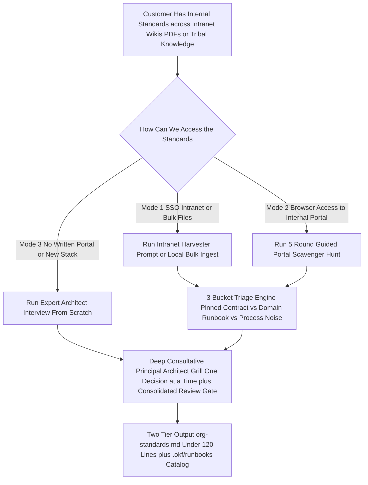

<!-- asdlc_version: "3.1.1" | distribution_tier: "customer-safe" -->
# Enterprise Organizational Standards Builder (`org-standards-builder`)

## 1. What Problem This Solves (For CEs and Customers)

In **Stage 1 of the Agentic SDLC (A/SDLC v3.1.1)**, every project needs an **`org-standards.md`** file so the AI agents know the customer's tech stack, security rules, testing gates, and observability standards.

In practice, building `org-standards.md` with enterprise customers hits three walls:
1. **The "300 Intranet Pages" Wall:** Large enterprises have hundreds of standards scattered across SharePoint, Confluence, Backstage, or internal portals. No human architect has all 300 pages memorized, so asking an agent to "interview the user from a blank page" fails.
2. **The "80% Bureaucratic Noise" Wall:** Most pages on a corporate standards portal cover human committee processes (Change Advisory Board schedules, ServiceNow ticket templates, HR sign-offs, or legacy mainframe policies) that an AI coding agent cannot enforce in code.
3. **The "Context Rot" Wall:** If a customer dumps 300 pages into `org-standards.md`, it blows up token budgets and drowns out real rules across Stages 2 through 8. Worse, if they copy a sample file that hardcodes a vendor demo stack, the agents enforce the wrong stack.

**`org-standards-builder`** is a **100% standalone skill and copy-paste prompt pack** that CEs and customers can run **before Stage 1** (or anytime) to distill hundreds of messy internal standards into a clean **Two-Tier A/SDLC v3.1.1 Standards Package**:
* **Tier 1 (`./org-standards.md`, strictly `<= 120 lines`):** Pinned in `.okf/manifest.yaml` for a 90% prefix context-cache discount across Stages 1 to 8. Contains only deterministic, code-enforceable rules tailored to the customer's actual stack.
* **Tier 2 (`./.okf/runbooks/*.md`):** Deep domain reference manuals (`architecture-and-apis.md`, `security-and-iam.md`, `data-and-storage.md`, `testing-and-ci.md`, `observability-and-finops.md`) loaded on demand only when an agent is working on that domain, plus `DISCARDED_PROCESS_LOG.md` so enterprise governance teams can see which non-code process pages were filtered out.

---

## 2. Three Ways Customers Can Run It



### Scenario A: The Customer Uses Google Antigravity IDE or Gemini CLI (Skill Installed)
1. Open the terminal or IDE in the project folder (or a shared standards repository).
2. Run:
   ```text
   /org-standards-builder
   ```
3. Pick **Mode 1 (Bulk/Harvester Ingest)**, **Mode 2 (Guided Portal Scavenger Hunt)**, or **Mode 3 (Expert Interview)** (with `Discuss details before deciding` always available), walk through each engineering conflict or numeric threshold one decision at a time in `DEEP_CONSULTATIVE` plain chat, and confirm the Consolidated Review Gate before generating `org-standards.md` and `.okf/runbooks/`.

### Scenario B: The Customer Has Hundreds of Pages on an SSO-Locked Intranet (Two-Step Prompt Flow)
When the customer's standards live on an internal SharePoint, Confluence, or intranet portal that their local terminal cannot crawl directly:
1. **Step 1 (Harvest Inside Their Enterprise Search Tool):** Give the customer [`prompts/INTRANET_HARVESTER_PROMPT.md`](./prompts/INTRANET_HARVESTER_PROMPT.md). Have them paste it into **Gemini Enterprise, Vertex AI Search, NotebookLM, M365 Copilot, or Glean** (which already has SSO access to their intranet). It will scan their catalog, strip out non-code bureaucracy, flag contradictions, and output `RAW_STANDARDS_EXTRACT.md`.
2. **Step 2 (Distill & Resolve Conflicts):** Feed `RAW_STANDARDS_EXTRACT.md` into `/org-standards-builder` (or paste [`prompts/STANDALONE_ARCHITECT_PROMPT.md`](./prompts/STANDALONE_ARCHITECT_PROMPT.md) into any chat window). The agent will grill their lead architect on the flagged contradictions, lock down hard numeric thresholds, and output the final `org-standards.md` (`<= 120 lines`) and `.okf/runbooks/` files.

### Scenario C: Zero-Install Browser Chat Only (Locked-Down Workstation)
If the customer is in a Phase 0 or Phase 1 workshop on a locked-down laptop with only a web browser:
1. Open [`prompts/STANDALONE_ARCHITECT_PROMPT.md`](./prompts/STANDALONE_ARCHITECT_PROMPT.md) and copy the prompt into their browser chat window.
2. Select **Option B (Guided Portal Scavenger Hunt)** on Turn 1.
3. The agent will guide them through 5 fast rounds, telling them the exact keywords to type into their internal website's search bar, cleaning up whatever messy text they paste in, and building `org-standards.md` at the end.

---

## 3. Package Contents

| File | Purpose |
| :--- | :--- |
| [`SKILL.md`](./SKILL.md) | Executable skill definition for Google Antigravity IDE or Gemini CLI (`/org-standards-builder`). |
| [`prompts/INTRANET_HARVESTER_PROMPT.md`](./prompts/INTRANET_HARVESTER_PROMPT.md) | Copy-paste prompt for Gemini Enterprise, NotebookLM, Copilot, or Glean to harvest hundreds of SSO-gated intranet pages into `RAW_STANDARDS_EXTRACT.md`. |
| [`prompts/STANDALONE_ARCHITECT_PROMPT.md`](./prompts/STANDALONE_ARCHITECT_PROMPT.md) | Copy-paste interactive architect prompt for any browser chat UI when the skill is not installed locally. |
| [`resources/ORG_STANDARDS_TEMPLATE.md`](./resources/ORG_STANDARDS_TEMPLATE.md) | Clean, stack-agnostic A/SDLC v3.0 `org-standards.md` template (`<= 120 lines`, Stages 1 to 8) with zero hardcoded vendor demo assumptions. |
| [`resources/RUNBOOK_INDEX_TEMPLATE.md`](./resources/RUNBOOK_INDEX_TEMPLATE.md) | Template for `.okf/runbooks/INDEX.md` indexing the 5 domain runbooks and the discarded process noise audit log. |
